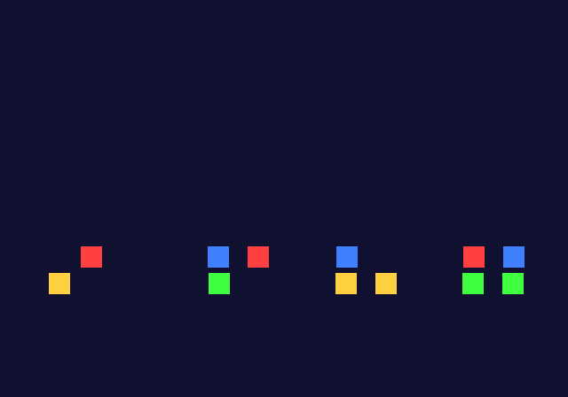
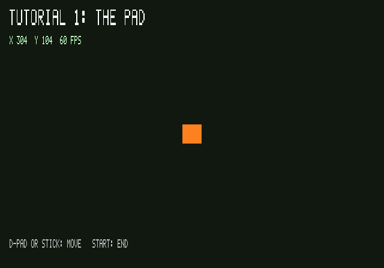

# Tutorial 1: the basics

This tutorial goes from a program that prints a line to a box on the screen that the pad
moves. On the way it covers how a maxsdk program starts and ends, how frames are drawn and
shown, what the GS is sent to draw something, and how the pad and on-screen text work.

## Step 1: a program that prints

[`1_hello.c`](1_hello.c)

```c
#include <mx/mx.h>

int main(int argc, char **argv) {
  mx_printf("hello from maxsdk: %d argument(s), the first %s\n", argc, argc > 0 ? argv[0] : "-");
  ...
  MX_TEST_END(0);
  return 0;
}
```

`<mx/mx.h>` brings in all of maxsdk's core: printing, the cycle counter, DMA, the GS, the frame
pipeline and the VUs. There is no ps2sdk below it. maxsdk calls the BIOS itself, and its own
start code (`crt/crt0.S`) sets up the stack, the heap and the arguments before `main`.

**Printing.** `mx_printf` writes to the debug console: PCSX2's EE console, or ps2client's
terminal on a PS2. It understands the usual formats, including `%f`.

**Timing.** `mx_count()` reads the EE's cycle counter, which counts at the CPU's clock,
294.912 MHz (`MX_EE_HZ`). It is 32 bits, so it wraps after about 14.6 seconds: subtract two
readings as unsigned numbers and keep the intervals short.

```c
u32 t0 = mx_count();
... the work ...
u32 cycles = mx_count() - t0;
```

**Ending.** `MX_TEST_END(status)` prints `@@PS2TEST_END@@ status=<status>`, the line that test
runners wait for. Returning from `main` ends the program. ps2link then restarts and waits for
the next one.

The output:

```
hello from maxsdk: 1 argument(s), the first host:1_hello.elf
the sum of 1/i for i = 1..1000 is 7.485247: 8204 cycles, 27904 ns
heap 0x11fbf0 .. 0x1fdf000
@@PS2TEST_END@@ status=0
```

## Step 2: the screen and the frame loop

[`2_screen.c`](2_screen.c)


Two calls set up the screen:

```c
mx_gs_init(640, 224);
mx_frame_init(ring, sizeof ring, (void *)0x70002000, 0x2000);
```

**`mx_gs_init(640, 224)`** sets the video mode, NTSC interlaced, and makes two framebuffers
and a Z buffer in the GS's 4 MB of memory. 224 lines is half of the 448 an interlaced NTSC
picture has. Each field (a half-picture, 60 per second) shows all 224 lines. This takes half
the memory of a 448-line frame, and every frame is shown complete. The price is that a line
is twice as tall as a pixel is wide. Later steps make shapes half as tall in lines as they
are wide in pixels for that reason.

**`mx_frame_init`** starts the frame pipeline. Everything a frame draws is collected into a
stream of packets, and DMA carries that stream to the GS (and to VU1, tutorial 3) while the
EE goes on. It needs two pieces of memory:
- **The ring:** a buffer the DMA reads from. Its size is a power of two and it is aligned to
  its size, hence `MX_ALIGNED(16 * 1024)`.
- **Scratchpad:** 8 KB of the EE's fast scratchpad RAM (at `0x70000000`, 16 KB in all), where
  the stream is built before it goes into the ring.

**The loop.** Each turn is one frame:

```c
for (u32 f = 0; f < FRAMES; f++) {
  mx_frame_begin(r, g, b);  /* wait for a free framebuffer, clear it */
  ... draw ...
  mx_frame_end();           /* send the frame off */
}
```

`mx_frame_begin` waits until a framebuffer is free, sets the GS up to draw into it, and
clears it to the colour (r, g, b). `mx_frame_end` ends the frame and pushes what is left of
it to the DMA. The GS draws it, and the vblank interrupt shows it once it is done. With two
framebuffers the GS draws one frame while the TV shows the one before, and `mx_frame_begin`
waits only when the EE is a whole frame ahead.

At 60 frames a second the program runs in step with the TV. `mx_gs` counts what happened. On
a PS2:

```
180 frames shown in 179 vblanks, 0 missed
```

That is one frame per vblank. `missed` counts the vblanks where the next frame was not drawn
in time. 179 rather than 180 because the first frame was drawn so quickly that it was shown in
the vblank that was already under way.

**The picture.** `tut_screenshot("host:2_screen.tga")` ([`../tut.h`](../tut.h)) waits until
the last frame is on the screen, stops the pipeline and copies the framebuffer out of GS
memory into a TGA file on the host. It is the last thing each step does.

## Step 3: drawing with GIF packets

[`3_sprites.c`](3_sprites.c)



The GS draws what it is sent as **GIF packets**: a 128-bit GIF tag, then data. The simplest
data is a list of register writes, each an **A+D** pair (the value, then the register's
number). A box takes four writes:

```c
u64 *c = mx_frame_direct(1 + 4);       /* room for the tag and 4 writes */
c = mx_e_ad_tag(c, 4, 1);              /* a GIF tag: 4 A+D writes, the end of the packet */
c = mx_e_ad(c, MX_GS_REG_PRIM, mx_gs_prim(MX_GS_PRIM_SPRITE, 0, 0, 0, 0, 0, 0, 0, 0));
c = mx_e_ad(c, MX_GS_REG_RGBAQ, mx_gs_rgbaq(r, g, b, 0x80, 1));
c = mx_e_ad(c, MX_GS_REG_XYZ2, mx_gs_xyz(mx_gs_px(x), mx_gs_py(y), 0));
c = mx_e_ad(c, MX_GS_REG_XYZ2, mx_gs_xyz(mx_gs_px(x + SIZE), mx_gs_py(y + SIZE / 2), 0));
mx_frame_commit(c);
```

- **`mx_frame_direct(n)`** reserves room for n quadwords of GIF packets in the frame and
  returns a cursor. The `mx_e_*` functions write at the cursor and return it moved on, and
  `mx_frame_commit` says how far it got. In the stream these packets go to the GS through
  VIF1's DIRECT command, called PATH2.
- **PRIM** says what the next vertices make: a sprite (an axis-aligned rectangle, two
  corners), triangles, lines or points. Its other fields switch on shading, texturing,
  blending and more (tutorial 2).
- **RGBAQ** is the colour of the vertices that follow. The colour channels go from 0 to 255.
  Alpha goes up to 0x80, which the GS takes as 1.0, i.e. opaque. The same 0x80 = 1.0 rule
  applies wherever the GS multiplies colours, as with textures and the HUD's text colour.
- **XYZ2** is a vertex. The second one completes the sprite and starts the drawing.

**Coordinates.** The GS works in a 4096 × 4096 space with 12.4 fixed point: 16 steps a pixel,
so things can be placed at a 16th of a pixel. The framebuffer is a window in that space (its
XYOFFSET), centred at (2048, 2048). `mx_gs_px(x)` and `mx_gs_py(y)` turn the screen's pixel
x and line y into it.

## Step 4: the pad and text

[`4_pad.c`](4_pad.c)



```c
#include <mx/hud.h>
#include <mx/pad.h>

mx_hud_init(mx_gs.tbp, 224);
mx_pad_init();
```

**The pad.** `mx_pad_init` loads the BIOS's pad driver and opens both ports. Each frame:
- `mx_pad_buttons(0)` gives the buttons held on port 0 (`MX_PAD_UP`, `MX_PAD_CROSS`, ...).
- `mx_pad_pressed(0)` gives those pressed since the last call, for one-time actions such as
  START here.
- `mx_pad_sticks(0, st)` gives the analog sticks (0–255, 128 in the middle) and returns 0 for
  a digital pad. A stick at rest is rarely exactly at 128, so the program ignores small values
  (a dead zone). Without one, the box creeps across the screen on its own.

**Text.** `mx_hud_init` makes a small font, 5 × 7 pixels for digits, capitals and
`" .:%/-"`, and uploads it into GS memory. `mx_gs.tbp` is the first free place after the
framebuffers. `mx_hud_text(x, y, text, rgb, scale)` then draws a string into the frame, and
`mx_hud_cat` and `mx_hud_u` build strings without `sprintf`. The positions are pixels and
lines of a 224-line screen.

**The frame rate** is counted against the vblanks: `mx_gs.vsync` counts them, and
`mx_gs.hz` of them make a second.

## What comes next

[Tutorial 2](../2-graphics/README.md) draws triangles, textures, transparency and depth: more of
what the GS can do with the packets from step 3.
