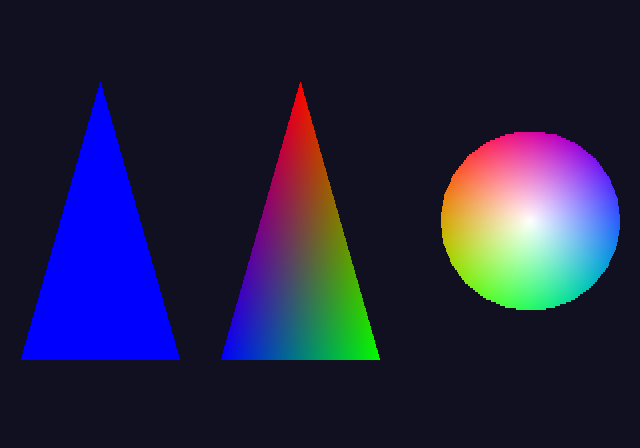
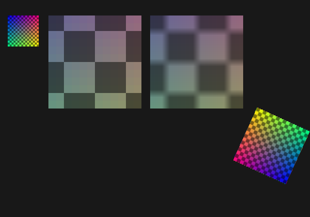
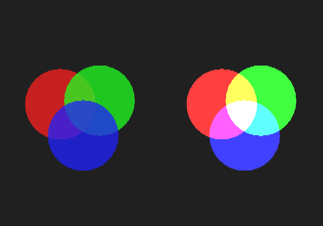

# Tutorial 2: graphics

[Tutorial 1](../1-basics/README.md) drew boxes with register writes. This tutorial uses more of
what the GS can do: triangles with smooth colours, textures, transparency and depth. Every
step is still the EE sending GIF packets to the GS. [Tutorial 3](../3-vu1-hlsl/README.md) moves
the per-vertex work to VU1.

## Step 1: triangles

[`1_triangles.c`](1_triangles.c)



**PACKED mode.** An A+D write takes a quadword for every register, each with the register's
number. For vertices there is a shorter form. The GIF tag lists the registers once and sets
PRIM itself, and each vertex is then one quadword per listed register:

```c
c = mx_e_giftag(c, n, 1, (s32)prim, MX_GIF_FLG_PACKED, 2,
                mx_gif_regs2(MX_GIF_REG_RGBAQ, MX_GIF_REG_XYZ2));
for (u32 i = 0; i < n; i++) {
  c = mx_e_rgbaq(c, v[i].r, v[i].g, v[i].b, 0x80);
  c = mx_e_xyz2(c, mx_gs_px(0) + (u32)(v[i].x * 16), mx_gs_py(0) + (u32)(v[i].y * 16), 0, 0);
}
```

The tag's fields:

| Field | Meaning |
|---|---|
| NLOOP (`n`) | how many times the register list repeats: here once per vertex |
| EOP (`1`) | the end of the packet |
| PRIM (`prim`) | written to the PRIM register before the data |
| FLG | `PACKED`: a quadword per register |
| NREG, REGS | 2 registers, RGBAQ then XYZ2 |

The positions are 12.4 fixed point, so `x * 16` places a vertex at a 16th of a pixel. The GS
draws the triangle's edges at that precision.

**Shading.** PRIM's IIP field picks how a triangle is coloured:
- **0, flat:** all of it in its last vertex's colour (left).
- **1, Gouraud:** the vertices' colours blended across it (middle).

```c
mx_gs_prim(MX_GS_PRIM_TRIANGLE, 0, ...)   /* flat */
mx_gs_prim(MX_GS_PRIM_TRIANGLE, 1, ...)   /* Gouraud */
mx_gs_prim(MX_GS_PRIM_TRIFAN, 1, ...)     /* a fan, Gouraud */
```

**Strips and fans** share vertices between triangles. In a fan (right) the first vertex is the
centre, and every new vertex makes a triangle with the centre and the vertex before. So 26
vertices make 24 triangles, where a plain triangle list would need 72. A strip
(`MX_GS_PRIM_TRISTRIP`) makes each new vertex a triangle with the two before it (step 2).

## Step 2: textures

[`2_texture.c`](2_texture.c)



A texture is drawn in three steps: made in main memory, sent into GS memory, then used when
drawing.

**1. Make it** in main memory: 64 × 64 texels of 32 bits, each `0xAABBGGRR`. Alpha 0x80 is
opaque. The texture is sent by DMA, which reads main memory, not the CPU's data cache, so the
cache is written back first:

```c
mx_dcache_writeback(tex, sizeof tex);
```

**2. Send it** into GS memory, after the framebuffers (`mx_gs.tbp`, in blocks of 256 bytes),
64 texels wide (the width is in units of 64):

```c
mx_frame_texture(0, tbp, 1, MX_GS_PSM_CT32, TW, TW, tex);
```

This goes over **PATH3**, the GIF's own DMA channel, alongside the frame stream. The first frame
waits for it to arrive, so nothing is drawn with a half-loaded texture:

```c
if (f == 0)
  mx_frame_wait_path3();
```

**3. Use it.** Three registers set it up:
- **TEX0:** where the texture is and its format, its size as powers of two (64 = 2⁶), and
  how it is applied. TFX 1 (DECAL) draws the texel as it is. TFX 0 (MODULATE) multiplies it
  by the vertex colour, with 0x80 as 1.0.
- **TEX1:** the filter. MMAG applies when a texel is larger than a pixel, MMIN when it is
  smaller; 0 is nearest, 1 is bilinear.
- **UV:** each vertex's texel, in 12.4 fixed point like XYZ2. PRIM needs TME 1 (textured) and
  FST 1 (UV, not the perspective-correct ST).

```c
const u64 tex0 = mx_gs_tex0(tbp, 1, MX_GS_PSM_CT32, 6, 6, 1, 1);
const u64 nearest = mx_gs_tex1(0, 0, 0, 0, 0, 0, 0);
const u64 bilinear = mx_gs_tex1(0, 0, 1, 1, 0, 0, 0);
```

In the picture:
- **Top left:** the texture at one texel a pixel. As lines are twice as tall, it is 64
  pixels by 32 lines.
- **Middle and right:** 12 × 12 texels enlarged 16 times. With nearest, each texel is a
  block. With bilinear, each pixel blends the four nearest texels.
- **Bottom right:** a strip of two triangles that turns. The texture follows the triangles,
  because each vertex carries its UV.

## Step 3: alpha blending

[`3_alpha.c`](3_alpha.c)



With ABE set in PRIM, the GS mixes each pixel it draws with the one already in the
framebuffer. The ALPHA register gives the formula:

> (A − B) × C / 128 + D

A, B and D are each Cs (the colour being drawn), Cd (the colour in the framebuffer) or 0. C is
As (the alpha being drawn), Ad (the framebuffer's alpha) or a fixed value FIX.

```c
const u64 blend = mx_gs_alpha(0, 1, 0, 1, 0);  /* (Cs - Cd) * As / 128 + Cd */
const u64 add = mx_gs_alpha(0, 2, 2, 1, 128);  /* (Cs - 0) * 128 / 128 + Cd = Cs + Cd */
```

- **Left, transparency:** with alpha 0x60 each circle covers three quarters of what is
  behind it. Where they overlap, the one drawn last is on top.
- **Right, additive:** the colours are added, so red, green and blue overlap to white. The
  sum is clamped at 255, because `mx_frame_begin` sets COLCLAMP. Without COLCLAMP it would
  wrap around.

Blending reads the framebuffer, so the order of drawing matters. Transparent things are drawn
after the opaque things behind them, and back to front among themselves.

## Step 4: the Z buffer

[`4_zbuffer.c`](4_zbuffer.c)


Each vertex has a depth Z, and the GS keeps the Z of every pixel in the Z buffer that
`mx_gs_init` made. Before drawing a pixel, the Z test compares its Z with the one in the
buffer. The TEST register sets this up:

```c
mx_gs_test(0, 0, 0, 0, 0, 0, 1, ztst)   /* ..., ZTE 1, ZTST */
```

| ZTST | A pixel is drawn |
|---|---|
| 0 never | never |
| 1 always | always (no test, but Z is still written) |
| 2 greater or equal | where its Z ≥ the buffer's: as near or nearer |
| 3 greater | where it is nearer |

Here a larger Z is nearer. `mx_frame_begin` clears the buffer to Z = 0, the farthest, and
the Z buffer is 24 bits, so Z goes up to 0xFFFFFF.

The two triangles cut through each other: the red one leans back to the left, the blue one
to the right.
- **Left, ZTST always:** the blue one, drawn last, covers the red one.
- **Right, ZTST greater or equal:** each shows where it is nearer, and the line where they
  cross appears by itself.

With the Z test the order of drawing no longer matters for solid things. This is what 3D
scenes need (tutorial 3).

## What comes next

So far the EE computes every vertex. [Tutorial 3](../3-vu1-hlsl/README.md) gives that work to
VU1, programmed in HLSL, and draws in 3D.
