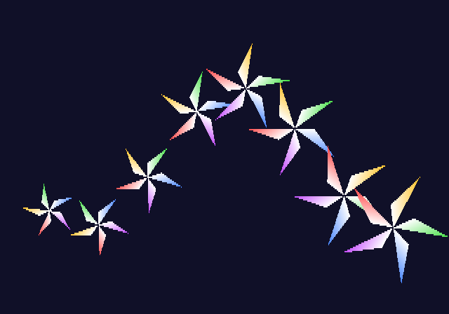
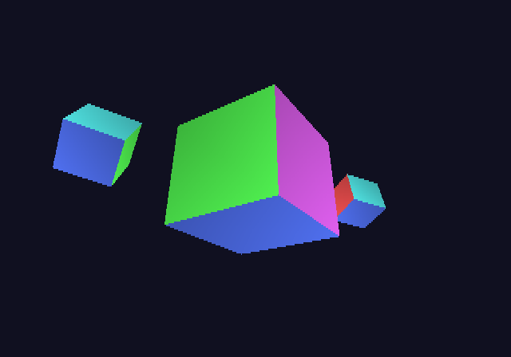
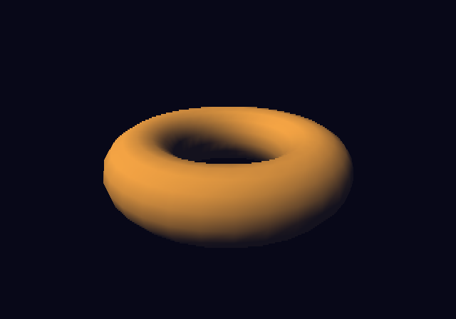

# Tutorial 3: VU1 and HLSL

In [tutorial 2](../2-graphics/README.md) the EE computed every vertex and wrote it into a GIF
packet. On the PS2 that is the job of **VU1**, the vector unit next to the GS. It transforms
vertices four floats at a time and sends its GIF packets straight to the GS (PATH1), while the
EE does other work.

In maxsdk, VU1's programs are written in **HLSL**, as vertex shaders. The toolchain compiles
them into VU1 microcode. This tutorial writes three of them: a 2D one, a 3D one, and one with
light.

## Step 1: a vertex program

[`t3_move.hlsl`](t3_move.hlsl), [`1_shader.c`](1_shader.c)



### The program

VU1 runs the program once for every vertex. It reads the vertex's **inputs** and writes the
**GIF registers** the GS draws it with:

```hlsl
#include "vu.hlsli"

cbuffer Uniforms {
    float4 turn;    // x: cos, y: sin of the angle; z: the size
    float4 offset;  // xy: where the shape's centre goes, in GS coordinates
};

struct In {
    float3 pos : POSITION;      // three floats a vertex (V3-32)
    uint4 col : COLOR_V4_8U;    // four bytes a vertex (V4-8, unsigned)
};

struct Out {
    int4 rgbaq : GIF_RGBAQ;
    int4 xyz2 : GIF_XYZ2;
};

[shader("vertex")]
Out t3_move(In v) {
    float2 p = float2(v.pos.x * turn.x - v.pos.y * turn.y,
                      (v.pos.x * turn.y + v.pos.y * turn.x) * 0.5) * turn.z;
    Out o;
    o.rgbaq = int4(v.col);
    o.xyz2 = vu::ftoi4(float4(p + offset.xy, 0, 1));
    return o;
}
```

- **Uniforms** (`cbuffer`) are the same for every vertex of a draw: here an angle, a size and a
  place. Each `float4` is one quadword of VU1 memory.
- **Inputs** (`In`) come from arrays in main memory. The semantic's suffix says how each is
  stored, and so how VU1's VIF unpacks it: `COLOR_V4_8U` is four unsigned bytes. Without a
  suffix the type decides: `float3` is three floats (V3-32). Small formats save memory and DMA
  time.
- **Outputs** (`Out`) are GIF registers, written in the order of the struct: here RGBAQ, then
  XYZ2, the same as tutorial 2's PACKED packets.
- **`vu::ftoi4`** (`include/vu.hlsli`) converts to the 12.4 fixed point of XYZ2: times 16,
  as integers.

Floats are the VU's strength. `int` and `uint` are 16 bits on the VU (its integer registers),
so keep integer arithmetic to small values. See [docs/hlsl.md](../../docs/hlsl.md) for the
details.

### How it is built

The Makefile names the directory of the HLSL files (`HLSL_DIRS`), and
[`mk/maxsdk.mk`](../../mk/maxsdk.mk) compiles each file with clang (HLSL to SPIR-V), opt and
llc (SPIR-V to VU1 code). The results are two files:
- `t3_move.o`: the microcode, between the symbols `t3_move_vu` and `t3_move_vu_end`.
- `t3_move.h`: the program's memory layout. A part of it:

```c
#define VU_T3_MOVE_TURN 0       /* the uniforms: quadword 0 ... */
#define VU_T3_MOVE_OFFSET 1     /* ... and 1 */
#define VU_T3_MOVE_UNI_QW 2     /* uniforms in all */
#define VU_T3_MOVE_MAX_N 125    /* vertices per batch */
#define VU_T3_MOVE_ALIGN 4      /* batches start at multiples of it */
#define VU_T3_MOVE_INPUTS {{0x8, 0, 12, 0x0}, {0xe, 1, 4, 0x0}}  /* the inputs' formats */
```

`MX_VU_SHADER` turns the code and the header into a `struct mx_shader`:

```c
#include "t3_move.h"
extern const u8 t3_move_vu[], t3_move_vu_end[];

const struct mx_shader s = MX_VU_SHADER(T3_MOVE, t3_move_vu, t3_move_vu_end);
```

### Drawing with it

The inputs are one array per input, called **streams**: `pos` (12 bytes a vertex) and `col`
(4 bytes a vertex). Each has room for `VU_T3_MOVE_ALIGN` vertices more than are drawn, because
a batch reads whole groups. The DMA reads them from memory, so they are written out of the
cache once they are made:

```c
static float pos[NV + VU_T3_MOVE_ALIGN][3] MX_ALIGNED(16);
static u8 col[NV + VU_T3_MOVE_ALIGN][4] MX_ALIGNED(16);
...
mx_dcache_writeback(pos, sizeof pos);
mx_dcache_writeback(col, sizeof col);
const void *streams[2] = {pos, col};
```

Each frame, after `mx_frame_begin`:

```c
mx_frame_shader_setup(&s);       /* the program into VU1 (once; then it stays there) */
float uni[VU_T3_MOVE_UNI_QW][4] MX_ALIGNED(16);
uni[VU_T3_MOVE_TURN][0] = ...;   /* the uniforms, where the header puts them */
mx_frame_shader_draw(&s, prim, uni, streams, NV);
```

`mx_frame_shader_draw` adds to the frame:
1. The uniforms, copied into the stream.
2. Then the vertices, in batches of up to `MAX_N`.

VU1's memory holds two batches. While VU1 transforms one and sends it to the GS, the next is
unpacked into the other half. `prim` is the PRIM register, as in tutorial 2: here Gouraud
triangles.

The uniforms are copied, so the same vertices can be drawn again with others straight away.
The picture is one pinwheel of 5 triangles, drawn eight times, each draw with its own angle,
size and place. `mx_vu_reset(2)` at the start resets VU1 (bit 1; bit 0 is VU0).

## Step 2: 3D

[`t3_cube.hlsl`](t3_cube.hlsl), [`camera.h`](camera.h), [`2_cube.c`](2_cube.c)



In 3D, one 4 × 4 matrix takes a vertex from the model to the screen. It combines three steps:
- **Model:** turn, scale and place the model.
- **View:** where the eye is. Here the eye is at the origin, looking along +z, so this step
  is part of the model's placement.
- **Projection:** onto the screen.

The EE multiplies them into one matrix per model, `mvp`. VU1 applies it to every vertex:

```hlsl
cbuffer Uniforms {
    float4x4 mvp;   // four quadwords, a column each
};
...
float4 p = mul(mvp, float4(v.pos, 1));
o.xyz2 = vu::ftoi4(p * rcp(p.w));
```

**The projection** ([`camera.h`](camera.h): `mat_project`) goes straight to GS coordinates. A
point at depth z goes to (2048 + FX·x/z, 2048 − FY·y/z), and objects get smaller with
distance because of the division by z:
- **FX = 457** gives a view 70 degrees wide over 640 pixels.
- **FY = FX × 0.467**, because the screen is 4:3 and its 224 lines are twice as tall as a
  pixel is wide.

The matrix puts z into w, so `p / p.w` is the division. `rcp` is the VU's divider, once per
vertex.

**Depth for the Z buffer.** The same matrix also gives Z = ZA/z + ZB, chosen so that Z runs
from `Z_FAR` at the far depth to `Z_NEAR` at the near one. More is nearer, as the Z test in
tutorial 2 step 4 expects. `ftoi4` multiplies Z by 16 too, and the Z buffer has 24 bits, so
`Z_NEAR` is at most 2²⁰. `z_test_on()` sets the Z test to "greater or equal".

**Uniform layout.** HLSL's `float4x4` in a cbuffer is stored column by column, a quadword per
column. `mat_uniform` writes the EE's matrix that way.

The scene draws one cube three times, each with its own matrix: a large one, and two small
ones that circle it, passing in front of it and behind it. The Z buffer sorts out what is in
front. Each face has its own colour and its corners differ a little, so Gouraud shading
shows.

## Step 3: light

[`t3_lit.hlsl`](t3_lit.hlsl), [`3_light.c`](3_light.c)



For light each vertex needs a **normal**, the direction its surface faces. Directional light
(like the sun) is brightest where the normal points at it, and the dot product of the two
measures that:
- 1 facing the light.
- 0 side on.
- Negative facing away; `max(.., 0)` turns that into 0.

```hlsl
cbuffer Uniforms {
    float4x4 mvp;
    float4 light;   // xyz: towards the light, length 1, in model space
    float4 colour;  // the surface lit full on (0 .. 255)
    float4 ambient; // the light from everywhere; w: alpha
};
...
float d = max(dot(v.nrm, light.xyz), 0.0);
o.rgbaq = vu::rgba8(float4(ambient.xyz + colour.xyz * d, ambient.w));
```

- **The light in model space.** The normals belong to the model, and the model turns. Rather
  than turn every normal, the EE turns the light the other way, once per draw. For a turn,
  the inverse is the transpose, so 3_light.c multiplies the light by the columns of the turn
  instead of its rows. VU1 then uses the normals as they are.
- **Ambient light** is added everywhere, so the side away from the light is dark but not
  black.
- **`vu::rgba8`** rounds the colour to the integers the GS reads. `int4(..)` would truncate,
  and costs an instruction more.

The torus is made once on the EE: 32 rings of 16 sides, 1024 triangles and 3072 vertices,
with a position and a normal each. It is sent in batches of up to `VU_T3_LIT_MAX_N` vertices
per draw. The light is computed per vertex and Gouraud shading blends it across each triangle.

## What comes next

- [docs/hlsl.md](../../docs/hlsl.md): everything the HLSL compiler for the VU does. That
  covers texture coordinates (`GIF_ST`), clipping, indexed drawing (a vertex shared by
  triangles transformed once), and programs for VU0.
- [`examples/vumax`](../../examples/vumax/): vertex programs from flat to lit and textured,
  and how fast VU1 runs them.
- `ps2max/apps/maxsdk_model`: a skinned, animated model drawn by HLSL programs.
